<picture>
  <source media="(prefers-color-scheme: dark)" srcset="assets/hero/mvalancy-dark.svg">
  
</picture>

Owner of [Valpatel Software](https://valpatel.com): autonomous systems, simulation and AI. Before that I designed test equipment across land, sea, air and space, and agricultural robots (Tesla, Joby, Astra, Monarch). Dublin, California.

### Recently updated

<!-- spotlight:start -->
<table>
<tr>
<td width="50%" valign="top">
<a href="https://cad-agent.valpatel.com"></a>
 
 <b>New</b> · Nov 13 · fix(site): use supported page paths for all…
</td>
<td width="50%" valign="top">
<a href="https://gyropup.com"></a>
 
 <b>New</b> · Nov 11 · Retain failed public C capture evidence and…
</td>
</tr>
<tr>
<td width="50%" valign="top">
<a href="https://github.com/mvalancy/val-ark"></a>
 
 <b>New</b> · Nov 2 · Release 0.1.19 — offline cad-agent mirror…
</td>
<td width="50%" valign="top">
<a href="https://github.com/mvalancy/j501-agx-orin"></a>
 
 <b>New</b> · Nov 11 · Record cellular display validation and…
</td>
</tr>
</table>
<!-- spotlight:end -->

<!-- activity:start -->

<b>Latest releases</b> · <a href="https://github.com/Valpatel/cad-agent/releases/tag/v0.41.1">cad-agent v0.41.1</a> Nov 13 · <a href="https://github.com/mvalancy/val-ark/releases/tag/0.1.19">val-ark 0.1.19</a> Nov 2

<!-- activity:end -->

### Valpatel

Some Valpatel work is closed source. The open projects link to their code; the live ones link to where you can use them.

<a href="https://graphlings.net"></a>
<a href="https://fight.graphlings.net/"></a>

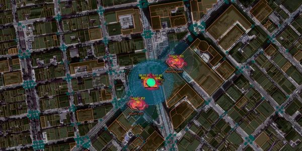
<a href="https://github.com/Valpatel/app-soundbox"></a>

### Graphs and agents

<a href="https://github.com/GraphDone/GraphDone-Core"></a>

### Robots, hardware and servers

<a href="https://github.com/mvalancy/moxie-robot-saver"></a>
<a href="https://github.com/mvalancy/pcb-agx-thor-can-breakout"></a>

### Teaching

<a href="https://github.com/mvalancy/csci-40_f26_demos"></a>

<b>Older projects</b> · [logitech_bcc950](https://github.com/mvalancy/logitech_bcc950) · [motor-ui-ddsm115-220](https://github.com/mvalancy/motor-ui-ddsm115-220) · [KiCAD_Libs](https://github.com/mvalancy/KiCAD_Libs) · [IC_Breakouts](https://github.com/mvalancy/IC_Breakouts) · [enphase-telegraf](https://github.com/mvalancy/enphase-telegraf) · [telegraf-slurm-cfg](https://github.com/mvalancy/telegraf-slurm-cfg) · [blender-nvidia-gb10](https://github.com/mvalancy/blender-nvidia-gb10) · [ovpn-connexa-python](https://github.com/mvalancy/ovpn-connexa-python) · [linux_tools](https://github.com/mvalancy/linux_tools) · <b>Archived</b> · [GraphDone](https://github.com/mvalancy/GraphDone) · [tritium-coder](https://github.com/mvalancy/tritium-coder) · <b>Forks</b> · [starnet-linux](https://github.com/mvalancy/starnet-linux) · [RCWS_v5](https://github.com/mvalancy/RCWS_v5) · [LucasCad](https://github.com/mvalancy/LucasCad)

The cards are animated SVGs drawn by [`tools/hero`](tools/hero/heroes.py) from each project's own content (CAD from its source, KiCad layouts, real screenshots, catalogues); they replay on a loop, and hold the finished frame still if your system asks for reduced motion. [`tools/profile`](tools/profile/update.py) refreshes the "what's new" lines under "Recently updated" daily (the four projects stay as chosen) from the public GitHub API.
