<picture>
  <source media="(prefers-color-scheme: dark)" srcset="assets/hero/mvalancy-dark.svg">
  
</picture>

Owner at [Valpatel Software](https://valpatel.com) — autonomous platforms, edge AI, robotics simulation. Dublin, California.

Full-stack generalist. Designed test equipment across land/sea/air/space domains and agricultural robotics (Tesla, Joby, Astra, Monarch). Now building independent thinking machines.

**Jump to:** [Valpatel](#valpatel) · [Robots and hardware](#robots-and-hardware) · [Servers and monitoring](#servers-and-monitoring) · [Teaching](#teaching) · [Archived and forks](#archived-and-forks)

---

## Valpatel

*Valpatel work is now closed source — initially open, consolidated behind one boundary as the
Graphlings work surfaced emergent capabilities. Earlier releases remain under the terms they were issued.*

<picture><source media="(prefers-color-scheme: dark)" srcset="assets/cards/gyropup-dark.svg"></picture>
<picture><source media="(prefers-color-scheme: dark)" srcset="assets/cards/cad-agent-dark.svg"></picture>
 <a href="https://github.com/Valpatel/gyropup">Gyropup</a> · <a href="https://github.com/Valpatel/cad-agent">cad-agent</a>

<picture><source media="(prefers-color-scheme: dark)" srcset="assets/cards/app-soundbox-dark.svg"></picture>
<picture><source media="(prefers-color-scheme: dark)" srcset="assets/cards/graphlings-dark.svg"></picture>
 <a href="https://github.com/Valpatel/app-soundbox">Sound Box</a> · <a href="https://graphlings.net">Graphlings</a>

<picture><source media="(prefers-color-scheme: dark)" srcset="assets/cards/tritium-dark.svg"></picture>
<picture><source media="(prefers-color-scheme: dark)" srcset="assets/cards/club-fight-dark.svg"></picture>

[**Gyropup**](https://github.com/Valpatel/gyropup) — A research robot designed to balance on two wheel-legs, with a foam-ball turret; CAD and simulation in the open. [gyropup.com](https://gyropup.com)

[**cad-agent**](https://github.com/Valpatel/cad-agent) — A workshop where AI agents get better at CAD by learning from everyone else.

**Tritium** *(private)* — Unified operating picture for target tracking and identification. Fuses BLE, WiFi, camera, radar, SDR, LoRa mesh, and acoustic sensors into one tactical map. 23+ plugins, pluggable AI commander, ESP32 edge firmware with 66+ HALs. Neighborhood security is too important to be a SaaS.

[**Sound Box**](https://github.com/Valpatel/app-soundbox) — Local synthetic audio generation box for AI agents and humans. MusicGen, AudioGen, MAGNeT, Piper TTS.

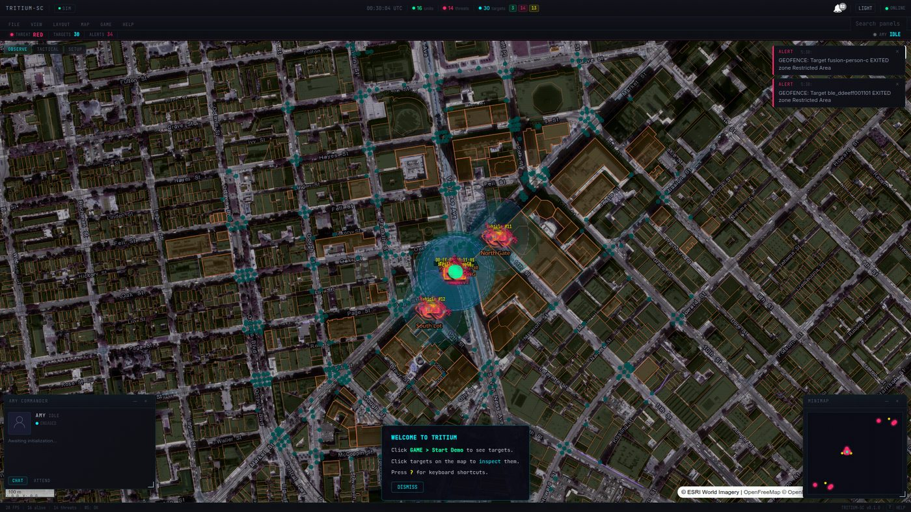 <a href="https://github.com/Valpatel/app-soundbox">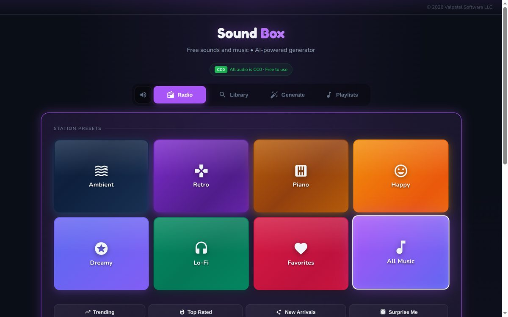</a>

[**Graphlings**](https://graphlings.net) *(private)* — Autonomous digital creatures with layered AI consciousness. Peer-to-peer mesh, cross-platform. Coming 2026.

<a href="https://graphlings.net">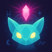</a>

**Club Fight** *(private)* — An animal fighting game.

---

## Robots and hardware

<picture><source media="(prefers-color-scheme: dark)" srcset="assets/cards/j501-agx-orin-dark.svg"></picture>
<picture><source media="(prefers-color-scheme: dark)" srcset="assets/cards/logitech_bcc950-dark.svg"></picture>
 <a href="https://github.com/mvalancy/j501-agx-orin">j501-agx-orin</a> · <a href="https://github.com/mvalancy/logitech_bcc950">logitech_bcc950</a>

<picture><source media="(prefers-color-scheme: dark)" srcset="assets/cards/moxie-robot-saver-dark.svg"></picture>
<picture><source media="(prefers-color-scheme: dark)" srcset="assets/cards/motor-ui-ddsm115-220-dark.svg"></picture>
 <a href="https://github.com/mvalancy/moxie-robot-saver">moxie-robot-saver</a> · <a href="https://github.com/mvalancy/motor-ui-ddsm115-220">motor-ui-ddsm115-220</a>

<picture><source media="(prefers-color-scheme: dark)" srcset="assets/cards/pcb-agx-thor-can-breakout-dark.svg"></picture>
<picture><source media="(prefers-color-scheme: dark)" srcset="assets/cards/KiCAD_Libs-dark.svg"></picture>
 <a href="https://github.com/mvalancy/pcb-agx-thor-can-breakout">pcb-agx-thor-can-breakout</a> · <a href="https://github.com/mvalancy/KiCAD_Libs">KiCAD_Libs</a>

<picture><source media="(prefers-color-scheme: dark)" srcset="assets/cards/IC_Breakouts-dark.svg"></picture>
 <a href="https://github.com/mvalancy/IC_Breakouts">IC_Breakouts</a>

[**logitech_bcc950**](https://github.com/mvalancy/logitech_bcc950) — A talking eyeball on a stick. PTZ camera control scripts.

[**motor-ui-ddsm115-220**](https://github.com/mvalancy/motor-ui-ddsm115-220) — Touch-friendly GUI for DDSM115/DDSM210 servo motors with real-time monitoring.

<a href="https://github.com/mvalancy/motor-ui-ddsm115-220">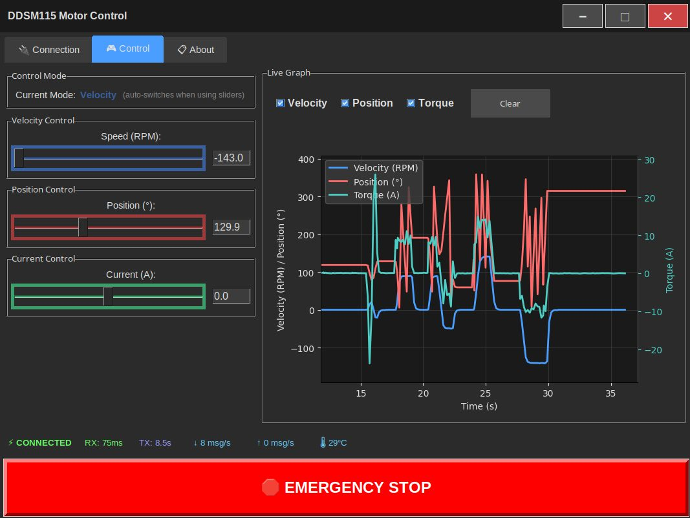</a>

---

## Servers and monitoring

<picture><source media="(prefers-color-scheme: dark)" srcset="assets/cards/val-ark-dark.svg"></picture>
<picture><source media="(prefers-color-scheme: dark)" srcset="assets/cards/cyberpower-pdu-dark.svg"></picture>
 <a href="https://github.com/mvalancy/val-ark">val-ark</a>

<picture><source media="(prefers-color-scheme: dark)" srcset="assets/cards/enphase-telegraf-dark.svg"></picture>
<picture><source media="(prefers-color-scheme: dark)" srcset="assets/cards/telegraf-slurm-cfg-dark.svg"></picture>
 <a href="https://github.com/mvalancy/enphase-telegraf">enphase-telegraf</a> · <a href="https://github.com/mvalancy/telegraf-slurm-cfg">telegraf-slurm-cfg</a>

<picture><source media="(prefers-color-scheme: dark)" srcset="assets/cards/blender-nvidia-gb10-dark.svg"></picture>
<picture><source media="(prefers-color-scheme: dark)" srcset="assets/cards/ovpn-connexa-python-dark.svg"></picture>
 <a href="https://github.com/mvalancy/blender-nvidia-gb10">blender-nvidia-gb10</a> · <a href="https://github.com/mvalancy/ovpn-connexa-python">ovpn-connexa-python</a>

<picture><source media="(prefers-color-scheme: dark)" srcset="assets/cards/linux_tools-dark.svg"></picture>
 <a href="https://github.com/mvalancy/linux_tools">linux_tools</a>

[**val-ark**](https://github.com/mvalancy/val-ark) — Offline-first tool server. Fills a disk with open-source software, AI models, and reference content, then serves it over local wifi.

**CyberPower-PDU** *(private)* — Self-hosted PDU monitoring dashboard with MQTT and Home Assistant integration.

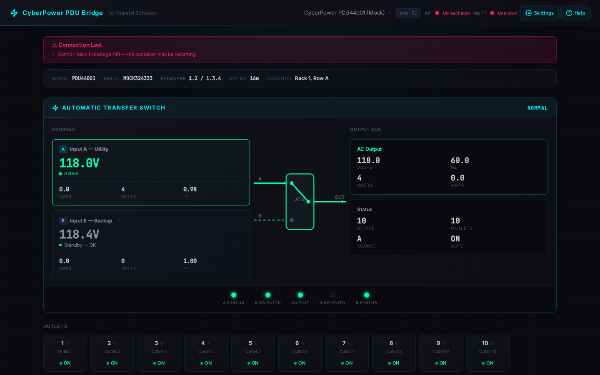

[**blender-nvidia-gb10**](https://github.com/mvalancy/blender-nvidia-gb10) — Build Blender 5.0.1 from source on NVIDIA DGX Spark / GB10 (ARM64, CUDA 13).

---

## Teaching

<picture><source media="(prefers-color-scheme: dark)" srcset="assets/cards/lesson-plans-dark.svg"></picture>
<picture><source media="(prefers-color-scheme: dark)" srcset="assets/cards/csci-40_f26_demos-dark.svg"></picture>
 <a href="https://github.com/mvalancy/lesson-plans">lesson-plans</a> · <a href="https://github.com/mvalancy/csci-40_f26_demos">csci-40_f26_demos</a>

---

## Archived and forks

Archived: [GraphDone](https://github.com/mvalancy/GraphDone) · [tritium-coder](https://github.com/mvalancy/tritium-coder).
Forks: [starnet-linux](https://github.com/mvalancy/starnet-linux) · [RCWS_v5](https://github.com/mvalancy/RCWS_v5) · [LucasCad](https://github.com/mvalancy/LucasCad).

Banners and cards are animated SVGs made by [`tools/hero`](tools/hero/heroes.py) from each project's own content (CAD traced from STEP files, catalogues, constants). They stop moving if your system asks for reduced motion.
